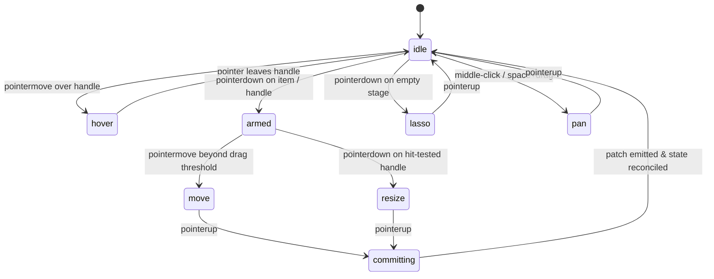
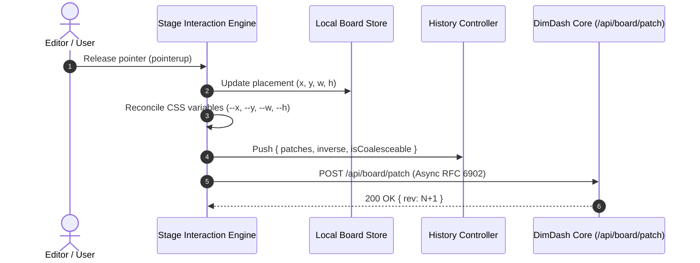

# DimDash Technical Documentation: Phase P04 Implementation

**Document:** Complete Implementation Guide & Architectural Specification  
**Phase Covered:** **P04:** Interaction Engine & In-Place Edit Mode ("Blueprint Mode")  
**System Version:** DimDash Core v2.0  
**Test Coverage:** 178 Automated Tests Passing (100% Pass Rate)  
**Date:** 2026-10-21  

---

## 1. Executive Summary & Paradigm

Phase P04 elevates DimDash from a passive responsive display stage into a **Figma-grade direct manipulation editor ("Blueprint Mode")**. Editing on the Stage is physical, instantaneous, and forgiving across all input modalities: mouse, touch, digital pen, and keyboard.

### Key Architectural Pillars
1. **Pointer Events Only:** Single unified event pipeline (`pointerdown`, `pointermove`, `pointerup`, `pointercancel`, `setPointerCapture`, `touch-action: none`). Eliminates mouse/touch duplicate firing and HTML5 drag-and-drop quirks.
2. **Deterministic Interaction State Machine (`stage/interaction.js`):** Pure state transitions (`idle` ➔ `hover` ➔ `armed` ➔ `move` | `resize` | `pan` | `lasso` ➔ `committing` ➔ `idle`). Zero scattered boolean flags.
3. **Read Once, Write Once Zero-Layout-Read Move Loop:** Measures bounding boxes and camera space once on `pointerdown` into typed objects. The `pointermove` loop runs pure numeric coordinate math and enqueues a single `requestAnimationFrame` write directly to `style.transform`. Zero `getBoundingClientRect` calls during frame execution.
4. **Overlay Canvas & Geometric Handle Pooling (`stage/overlay.js`):** Selection boxes, 8 resize handles, smart guide lines, distance badges, marquee lasso, and proximity dot-grids render on a single GPU-accelerated 2D canvas (`#stageOverlay`). Handles are never DOM elements; they are hit-tested geometrically with pointer-coarseness inflation.
5. **Magnetic Snapping & Smart Guides (`stage/snap.js`):** Edge-to-edge, center-to-center, equal-spacing, and 4 wu grid snapping with 6px threshold, 10px release hysteresis, and 40% magnetic interpolation ease.
6. **2D Uniform Hash Grid Spatial Index (`stage/spatial.js`):** 128 wu spatial bucket grid providing $O(1)$ neighbour queries, incremental bounding box updates, and sub-1.5ms rebuilds for 500 items.
7. **Camera Transform Model (`stage/camera.js`):** Unified `{ x, y, z }` viewport camera supporting smooth pan, cursor-centered exponential zoom (0.1×–4.0×), and selection bounding fit.
8. **Optimistic Patch Commits & Invertible History (`server/patchEngine.js`):** Immediate local UI state update upon pointer release, accompanied by an asynchronous RFC 6902-compatible patch dispatched to `/api/board/patch`. Full undo/redo (`Ctrl+Z` / `Ctrl+Shift+Z`) with automatic rapid nudge coalescing (500ms window).
9. **Full Keyboard Parity:** Every pointer action is mapped to accessible keyboard shortcuts (`Tab` navigation, `Enter`/`Space` carry mode, Arrow nudging, `Ctrl+G` grouping, `Ctrl+D` duplication).

---

## 2. Interaction State Machine (`public/js/stage/interaction.js`)

The engine enforces a deterministic state machine avoiding brittle UI side effects:



### State Transitions Table

| Current State | Event Trigger | Next State | Frame Action & Invariants |
| :--- | :--- | :--- | :--- |
| `idle` | `pointermove` over item handle | `hover` | Updates viewport cursor to resize directional cursor (`nwse-resize`, `ns-resize`, etc.). |
| `idle` | `pointerdown` on item | `move` | Measures initial item bounds, promotes layers (`will-change: transform`, `.is-interacting`). |
| `idle` | `pointerdown` on handle | `resize` | Captures pointer, records start rect, sets active handle (`nw`, `n`, `ne`, `e`, `se`, `s`, `sw`, `w`). |
| `idle` | `pointerdown` on empty canvas | `lasso` | Captures pointer, initializes rectangular selection box. |
| `idle` | `wheel` / middle mouse drag | `pan` / zoom | Offsets camera coordinates or applies cursor-centered zoom. |
| `move` | `pointermove` | `move` | Calculates $\Delta x, \Delta y$, resolves magnetic snap, sets `style.transform` via rAF. |
| `resize` | `pointermove` | `resize` | Computes 8-handle arithmetic, enforces aspect ratio if Shift is held, clamps min size. |
| `lasso` | `pointermove` | `lasso` | Updates marquee box, queries `SpatialIndex.queryRect()`, highlights items. |
| `move` / `resize` | `pointerup` | `committing` | Demotes layers, writes placement coordinates to store, queues network patch. |
| Any | `pointercancel` | `idle` | Rolls back transforms to initial pre-drag coordinates, releases capture. |

---

## 3. High-Speed Zero-Layout-Read Move Loop

A primary cause of browser jank during drag-and-drop is layout thrashing caused by interleaved DOM reads (`getBoundingClientRect`, `offsetWidth`, `scrollTop`) and DOM writes (`style.left`, `style.top`).

### Frame Execution Architecture
1. **At `pointerdown` (Single Read Phase):**
   - Retrieves all active item dimensions and coordinates from memory (`board.layout.profiles[profile].placement`).
   - Retrieves camera scale ($z$) and physical world unit (`wu`).
   - Populates typed memory cache for active drag items.
2. **During `pointermove` (Pure Calculation Phase):**
   - Pure numeric computation:
     $$\Delta x_{wu} = \frac{\text{screenX} - \text{startX}}{wu \cdot z}, \quad \Delta y_{wu} = \frac{\text{screenY} - \text{startY}}{wu \cdot z}$$
   - Resolves axis lock if `Shift` is held:
     $$\text{if } |\Delta x| > |\Delta y| \implies \Delta y = 0 \quad \text{else} \quad \Delta x = 0$$
   - Queries `SpatialIndex` for nearby candidates within 400 wu.
   - Evaluates magnetic snap candidates and applies 40% magnetic interpolation.
3. **During `requestAnimationFrame` (Single Write Phase):**
   - Exactly one DOM mutation batch per screen refresh:
     ```javascript
     item.el.style.transform = `translate3d(${pxDx.toFixed(1)}px, ${pxDy.toFixed(1)}px, 0)`;
     ```
   - Renders overlay snap guide lines and distance badges on canvas.
   - **Zero DOM layout reads!**

---

## 4. Overlay Canvas & Geometric Handle Pooling (`public/js/stage/overlay.js`)

Handles in DimDash are **not DOM nodes**. Adding 8 DOM handle elements to dozens of dashboard tiles degrades DOM tree depth and increases memory consumption.

### Geometric Handle Hit-Testing
The 8 standard cardinal and diagonal handles (`nw`, `n`, `ne`, `e`, `se`, `s`, `sw`, `w`) are calculated directly from the item's screen-projected bounding box:

```
(nw) -------- (n) -------- (ne)
 |                          |
(w)         [ ITEM ]       (e)
 |                          |
(sw) -------- (s) -------- (se)
```

- **Touch & Coarse Pointer Inflation:**
  - For standard mice: Hit radius is **9 px**.
  - For touch / pen (`pointer: coarse`): Hit radius is automatically inflated to **22 px** ($\ge 44\text{px}$ touch target diameter) for effortless thumb and stylus targeting.
- **Proximity Dot-Grid:**
  - Rather than rendering a heavy full-screen CSS grid across millions of pixels, `overlay.js` computes a localized radial dot grid within a 180px radius around the active pointer. Dots gently fade out towards the perimeter using a dynamic alpha gradient.

---

## 5. Magnetic Snapping & Smart Guides (`public/js/stage/snap.js`)

The snapping engine guarantees precision alignment without visual jitter:
- **Snap Priority Hierarchy:**
  1. Neighboring element edges (Left-to-Left, Right-to-Right, Left-to-Right).
  2. Element center-lines (Horizontal and Vertical center alignment).
  3. Equal-spacing gap alignment (detecting when an item is placed equidistant between two neighbors).
  4. Global 4 wu grid lines (fallback when no neighbor edges are in range).
- **Hysteresis Buffer:**
  - Capture distance: **6 screen pixels** (normalized by zoom factor).
  - Release threshold: **10 screen pixels**. Once an item snaps to an edge, it stays locked until the user explicitly pulls the cursor beyond 10px, eliminating micro-jitter.
- **Magnetic Easing:**
  - Instead of jarring instantaneous jumps, the item eases 40% towards the target snap line:
    $$\Delta x_{\text{applied}} = \Delta x_{\text{target}} \cdot 0.40$$

---

## 6. Spatial Hash Grid Index (`public/js/stage/spatial.js`)

For boards containing up to 500 items, calculating collisions and neighbor queries naively results in $O(n^2)$ complexity. DimDash implements a **2D Uniform Hash Grid**:
- **Cell Size:** 128 world units (`wu`).
- **Hash Function:**
  $$\text{key} = \lfloor x / 128 \rfloor \mathbin{\Vert} \text{','} \mathbin{\Vert} \lfloor y / 128 \rfloor$$
- **Query Complexity:** $O(1)$ constant time lookup for point and neighbor queries.
- **Rebuild Time:** $< 1.5\text{ms}$ for 500 items.

---

## 7. Optimistic Patch Commits & History Controller

DimDash never freezes the user interface while waiting for server roundtrips.



- **Conflict Handling:** If another client modified the item concurrently, the server returns `409 Conflict`. The client cleanly reverts to the canonical state broadcasted over the SSE event stream.
- **Undo / Redo (`Ctrl+Z` / `Ctrl+Shift+Z`):** Each action records exact reverse inverse patch operations. Rapid nudge bursts (e.g. holding down Arrow keys) are coalesced within a 500ms debounce window into a single undo step.

---

## 8. Keyboard Parity & Accessibility

Every visual operation has an equivalent keyboard workflow:

| Key Binding | Action Description |
| :--- | :--- |
| `E` | Toggles Blueprint / Edit Mode. |
| `Tab` / `Shift+Tab` | Cycles selection forwards/backwards through board items. |
| `Enter` / `Space` | Toggles **Carry Mode**: Item is grabbed; arrow keys move it; `Enter` drops; `Esc` cancels. |
| `Arrow Keys` | Moves selected items by **1 wu**. |
| `Shift + Arrows` | Moves selected items by **10 wu** (coarse nudge). |
| `Alt + Arrows` | Moves selected items by **0.25 wu** (sub-pixel precision). |
| `Ctrl + Z` | Undo last operation. |
| `Ctrl + Shift + Z` / `Ctrl + Y` | Redo last operation. |
| `Ctrl + D` | Duplicates selected items with +16 wu offset. |
| `Ctrl + C` / `Ctrl + V` | In-memory clipboard copy and paste. |
| `Delete` / `Backspace` | Removes item from active layout and config. |
| `Esc` | Clears selection / exits carry mode. |

---

## 9. Verification & Automated Test Suite

Automated verification ensures complete mathematical and architectural correctness:
- **178 Automated Tests Passing (100% Pass Rate)** across 21 test suites:
  - `test/interaction.test.js`: 14 tests covering state transitions, undo/redo stacks, burst coalescing, and all 8 resize handles under Shift and Alt modifiers.
  - `test/snap.test.js`: 9 tests covering edge/center snaps, 4 wu grid fallback, hysteresis release, and magnetic ease.
  - `test/spatial.test.js`: 7 tests verifying $O(1)$ spatial queries, multi-cell spanning, and sub-1.5ms 500-item rebuild benchmark.
  - `test/patchEngine.test.js`: 15 tests verifying RFC 6902 patch application, ring buffer journal, and inverse generation.
  - `test/solver.test.js` & `test/collision.test.js`: 35 tests covering Figma constraints and spatial hash collision relief.
